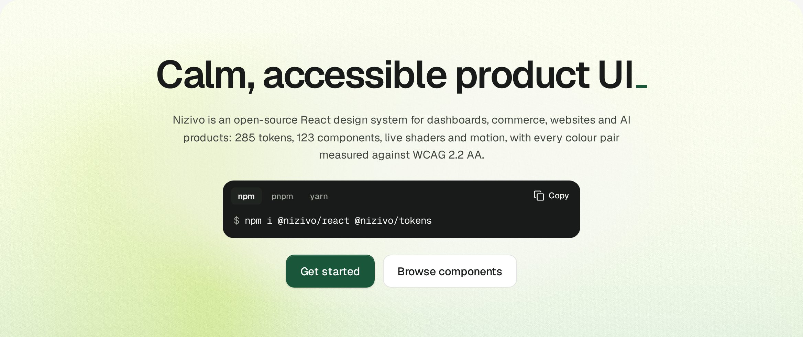

<div align="center">

<a href="https://nizivo.neevtechnologies.in"></a>

# Nizivo UI

**Calm, accessible product UI for React.**

An open-source, server-first React design system by Neev Technologies: design tokens, components,
charts and icons for dashboards, commerce, websites and AI products.

[](https://www.npmjs.com/package/@nizivo/react)
[](LICENSE)
[](https://react.dev)
[](packages/react)
[](https://nizivo.neevtechnologies.in/docs/guides/static-or-interactive/)
[](packages/tokens/CONTRAST.md)
[](https://github.com/theneev/nizivo/stargazers)

[Docs](https://nizivo.neevtechnologies.in/docs/) ·
[Components](https://nizivo.neevtechnologies.in/docs/components/) ·
[Getting started](https://nizivo.neevtechnologies.in/docs/getting-started/next/) ·
[Changelog](https://nizivo.neevtechnologies.in/docs/changelog/) ·
[Registry](https://nizivo.neevtechnologies.in/docs/guides/registry/)

<a href="https://nizivo.neevtechnologies.in">
  <picture>
    <source media="(prefers-color-scheme: dark)" srcset="docs/assets/readme-hero-dark.jpg">
    
  </picture>
</a>

</div>

## Why Nizivo

- **Server-first.** Components are React Server Components by default; `'use client'` sits only on
  interactive leaves. A page that renders a Button, a Card or a Field with a native control ships no
  Nizivo JavaScript, and no provider is required.
- **Accessible by default.** Native elements first, and React Aria where the platform falls short.
  Every colour pair in the tokens is measured against WCAG 2.2 AA
  ([CONTRAST.md](packages/tokens/CONTRAST.md)), and every docs page passes axe in light and dark.
- **One set of tokens.** Light and dark come from one `light-dark()` value per colour, so any subtree
  switches theme with one attribute. The same tokens ship as CSS, JSON and typed references.
- **Plain CSS.** Each component's stylesheet reads only public `--nz-*` tokens, in a fixed layer order,
  so it works with or without Tailwind CSS v4 (there is an adapter), and your own unlayered CSS
  always wins over it.
- **Measured, not guessed.** Size budgets come from measurements and are checked on every change.

## Quick start

```sh
npm i @nizivo/react @nizivo/tokens
```

Import the CSS once, in your root layout: the tokens, the accessibility floor, then one file per
component you use (or `@nizivo/react/styles.css` for all of them).

```tsx
// app/layout.tsx
import '@nizivo/tokens/tokens.css';
import '@nizivo/react/css/base.css';
import '@nizivo/react/css/button.css';
import '@nizivo/react/css/card.css';

export default function RootLayout({ children }: { children: React.ReactNode }) {
  return (
    <html lang="en" data-nz-theme="system">
      <body>{children}</body>
    </html>
  );
}
```

Import each component from its own subpath. This page is a Server Component:

```tsx
// app/page.tsx
import { Button } from '@nizivo/react/button';
import { Card } from '@nizivo/react/card';

export default function Page() {
  return (
    <Card.Root>
      <Card.Header>
        <Card.Title>Top products</Card.Title>
        <Card.Description>Last 30 days</Card.Description>
      </Card.Header>
      <Card.Footer>
        <Button>Export</Button>
      </Card.Footer>
    </Card.Root>
  );
}
```

`data-nz-theme="system"` follows the operating system with no script and no flash. The setup guides
cover the browser targets that keep `light-dark()` intact, a theme switch, CSP and more:
[Next.js](https://nizivo.neevtechnologies.in/docs/getting-started/next/),
[Vite](https://nizivo.neevtechnologies.in/docs/getting-started/vite/),
[React Router](https://nizivo.neevtechnologies.in/docs/getting-started/react-router/),
[TanStack Start](https://nizivo.neevtechnologies.in/docs/getting-started/tanstack-start/),
[Astro](https://nizivo.neevtechnologies.in/docs/getting-started/astro/) and
[Tailwind CSS](https://nizivo.neevtechnologies.in/docs/getting-started/tailwind/). Each one is checked
by a fixture app in [`fixtures/`](fixtures) on the packed packages.

## Packages

| Package                             | Version                                                                                                                     | What it is                                                                                       |
| ----------------------------------- | --------------------------------------------------------------------------------------------------------------------------- | ------------------------------------------------------------------------------------------------ |
| [`@nizivo/react`](packages/react)   | [](https://www.npmjs.com/package/@nizivo/react)   | Components and their static CSS. Server Components by default; `'use client'` only on leaves     |
| [`@nizivo/tokens`](packages/tokens) | [](https://www.npmjs.com/package/@nizivo/tokens) | Design tokens as CSS variables, theme scopes, motion, JSON and typed references. No dependencies |
| [`@nizivo/icons`](packages/icons)   | [](https://www.npmjs.com/package/@nizivo/icons)   | Every Lucide icon at the Nizivo stroke, plus brand glyphs; zero client JavaScript                |
| [`@nizivo/charts`](packages/charts) | [](https://www.npmjs.com/package/@nizivo/charts) | Server-rendered SVG charts (area, bar, donut, funnel, heatmap, sparkline) with one small island  |

The four release together at the same version. They are ESM-only, need Node `>=22.12`, and all but
`@nizivo/tokens` need React `^19.2.0`.

The AI kit, the marketing and docs-site parts, the shaders and the motion parts live under
`@nizivo/react/unstable/<name>`. They are outside semver until they are promoted.

## Copy instead of install

Patterns such as a product card or an orders page, and any component's stylesheet, are also items
for the [shadcn CLI](https://ui.shadcn.com/docs/registry). Each release has its own immutable URL, and
the copied files are yours to edit under MIT:

```sh
npx shadcn@latest add https://nizivo.neevtechnologies.in/r/latest/product-card.json
```

See [the registry guide](https://nizivo.neevtechnologies.in/docs/guides/registry/).

## Status

**Pre-1.0.** The packages are on npm. Until 1.0, a minor release may break, always with a
`BREAKING` note in the [changelog](https://nizivo.neevtechnologies.in/docs/changelog/). The plan, every
decision and what comes next are in [docs/ARCHITECTURE.md](docs/ARCHITECTURE.md).

Browser support starts at Chrome and Edge 123, Firefox 129, and Safari and iOS 17.5.

## Contributing

Issues and pull requests are welcome. [CONTRIBUTING.md](CONTRIBUTING.md) covers setup (Node 24 and
pnpm 12.11.2 through corepack), the checks a change must pass, commit conventions, the DCO sign-off
and changesets. Please report security issues privately, as [SECURITY.md](SECURITY.md) describes.

## Licence

Copyright 2026 Neev Technologies. Licensed under the [Apache License 2.0](LICENSE). Items in
[`patterns/`](patterns) are licensed under [MIT](patterns/LICENSE). "Nizivo" and the Nizivo logo are
trademarks of Neev Technologies; see [TRADEMARKS.md](TRADEMARKS.md).

<div align="center">
<br>
<sub>Grown with care by Neev Technologies 🌱</sub>
</div>
